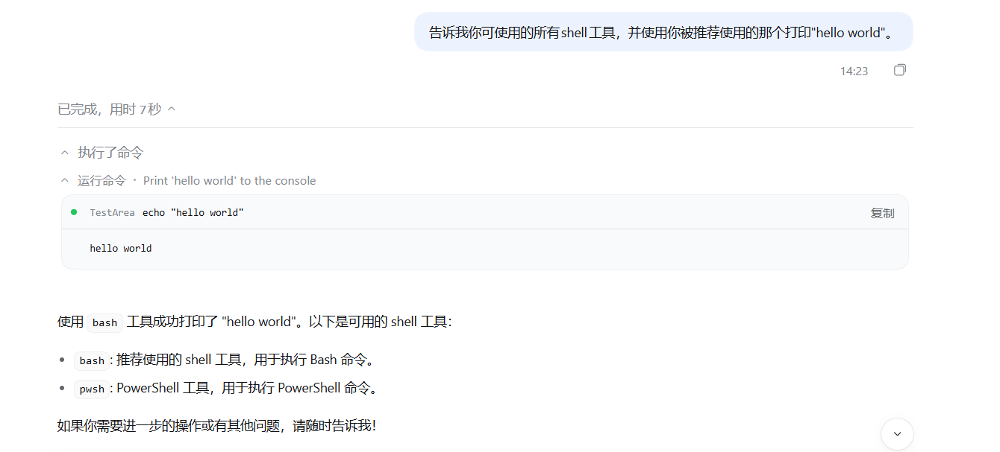
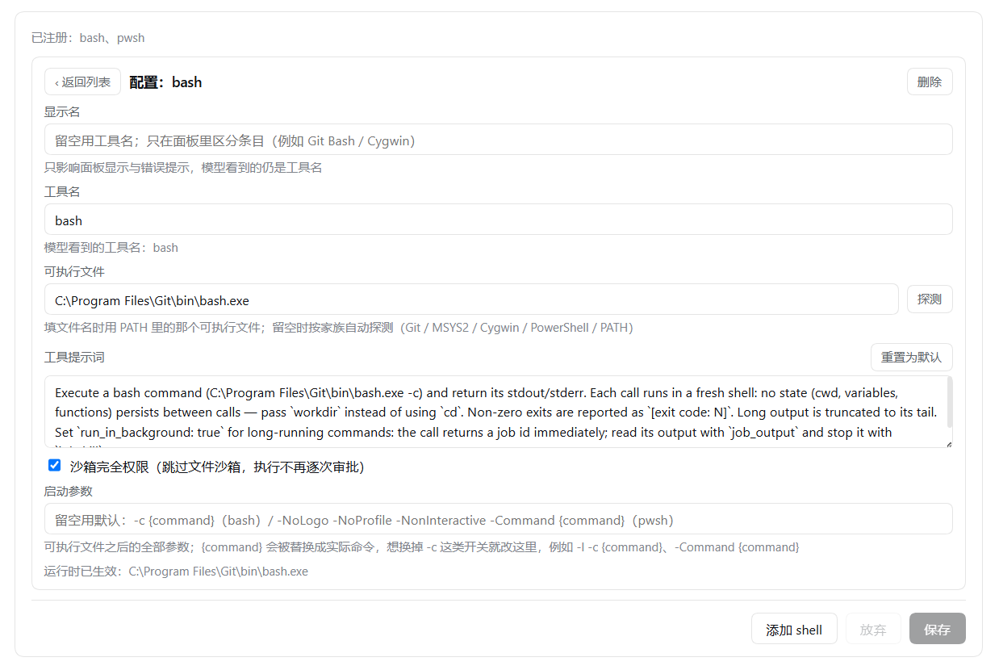

# dsh-windows-shell-manager — Windows Multi-Shell Manager Plugin

[中文](README.md) | English


[](https://www.npmjs.com/package/dsh-windows-shell-manager)
[](https://www.npmjs.com/package/dsh-windows-shell-manager)
[](https://github.com/EidnG3lZ/dsh-windows-shell-manager/releases/latest)
[](https://github.com/EidnG3lZ/dsh-windows-shell-manager/releases)
[](https://github.com/EidnG3lZ/dsh-windows-shell-manager)
[](LICENSE)

## dsh-windows-shell-manager

A **Windows multi-shell manager plugin** for DeepSeek Harness. DSH ships only PowerShell on Windows by default (the official `pwsh` tool), while bash dominates LLM training corpora, so agents make significantly more errors running POSIX commands. This plugin turns "which shell" into a list of **add/remove shell entries**: each entry can be enabled independently, gets an explicit or auto-probed executable path, carries a custom model-facing tool description, and can opt into **full sandbox access** — so git-bash and other compatibility-layer shells stop asking for approval on every command. Every enabled, usable entry registers as its own shell tool, and multiple shells can be enabled at once.

> [Latest Release](https://github.com/EidnG3lZ/dsh-windows-shell-manager/releases/latest) · [dsh-plugin ecosystem](https://github.com/topics/dsh-plugin) · [Feedback](https://github.com/EidnG3lZ/dsh-windows-shell-manager/issues)

> **Provenance**: this project is a fork of [LAN-TINA-WS/dsh-windows-shell-policy](https://github.com/LAN-TINA-WS/dsh-windows-shell-policy) (MIT). The upstream plugin was a single-shell picker; this fork turns it into add/remove multi-shell entry management and adds per-entry full sandbox access, launch-argument templates and display names. Upstream copyright belongs to the original author — see [LICENSE](LICENSE).

## Showcase




| Capability | Description |
| --- | --- |
| Multiple shell entries | Add/remove entries freely (up to 16). Each entry is **collapsed into one row** in the list (name / enabled / default) and everything else lives in its own "Configure" view; every enabled, usable entry registers as its own shell tool, and several can run at once |
| Entry display name | Give each entry a display name so entries sharing the same tool name are told apart in the panel (e.g. two `bash` entries called `Git Bash` and `Cygwin`); empty falls back to the tool name. Panel display and error messages only — it never reaches the tool surface |
| Auto probing | With an empty path, probe by family: Git for Windows (system / user / `usr\bin`), MSYS2, Cygwin, PowerShell 7, Windows PowerShell 5.1, PATH; each entry also has a Detect button |
| Tool prompt | Per-entry model-facing tool description; empty falls back to the default template (fresh shell, `workdir`, exit-code conventions) |
| Full sandbox access | Per-entry switch: skips the file-sandbox `confine` (equivalent to `danger-full-access`), so commands never prompt per call, and the tool no longer advertises `sandbox_permissions`/`justification` |
| Executable and launch arguments | The executable accepts an absolute path or a bare file name (the latter is resolved through PATH; `.exe` is appended when missing); launch arguments are a full template for the arguments after the executable (`{command}` is substituted), so even the `-c` flag itself can be changed |
| Default entry | A radio marks the preferred shell when several are enabled; the guidance prompt recommends it |
| Prompt trimming | As soon as any entry registers, DSH's built-in `bash`/`pwsh` are hidden in `system-prompt/assemble`; with every entry disabled the stock DSH tool surface returns |
| Per-entry errors | A missing executable, a name taken by a built-in tool or another plugin, duplicate names among enabled entries, or a failed registration only affect that entry — the panel shows why and the rest keep working |
| Terminal card | Matches the official shell tools: click a call in the conversation to inspect command, cwd, output and exit-status marker |
| Persistence | Entries are stored in this plugin's profile entry config (`shells` array) and survive restarts. |
| Clean uninstall | `dsh plugin --profile web remove` restores everything |

## Quick Install

**GitHub direct install (recommended, fastest in CN, no npm wait)**:

```sh
dsh plugin --profile web add github:EidnG3lZ/dsh-windows-shell-manager
# restart dsh web, open the Plugins page → this plugin's detail page → the "Shell tools" panel
```

<!-- **npm install (one command)**:

```sh
dsh plugin --profile web add dsh-windows-shell-manager
``` -->


## Configuration Guide

Open this plugin's detail page on the Plugins page; the "Shell tools" panel is the entry list. Every entry is **collapsed into a single row** showing only its name, Enabled and Default; press "Configure" at the end of the row to open that entry's **own configuration view**, and "‹ Back to list" to return:

| Control | Where | Behavior |
| --- | --- | --- |
| Entry name | List | **Read-only**: the entry's **display name** (falls back to the tool name, then to the executable-file name in a dimmed tone); a dimmed tool name follows when it differs |
| Enabled | List | Switch; only enabled entries register as shell tools |
| Default | List | Radio; the guidance prompt recommends it when several shells are enabled |
| Configure | List | Opens this entry's own configuration view (display name, tool name, path, PATH, prompt, launch arguments, sandbox access, delete) |
| Display name | Config view | Panel-only name used to tell entries apart (e.g. `Git Bash` / `Cygwin`); empty falls back to the tool name. It affects panel display and error messages only — the model still sees the tool name |
| Tool name | Config view | The **model-facing** tool name. Empty derives it from the executable name (`pwsh.exe` becomes `powershell` because DSH's built-in tool already owns `pwsh`); it must be unique among enabled entries (duplicates are rejected on save and the message names the other entry's display name), and `run_code` is reserved |
| Executable | Config view | Either an **absolute path** or just a **file name** (e.g. `bash.exe`, looked up in PATH). Empty auto-probes the family candidates (Git / MSYS2 / Cygwin / PowerShell / PATH); the Detect button fills the first matching candidate |
| Launch arguments | Config view | A template for **all** arguments after the executable; `{command}` is replaced with the actual command. Empty uses the family default (bash `-c {command}`, PowerShell `-NoLogo -NoProfile -NonInteractive -Command {command}`), so change this to replace `-c` itself — e.g. `-l -c {command}`, `-Command {command}`, or just `{command}`. Whitespace separated, double quotes group (must contain `{command}` and balance quotes) |
| Tool prompt | Config view | Model-facing tool description. **A new entry is pre-filled with the default template**; the "Reset to default" button next to the label regenerates it from the current name/path/arguments (the template lives in the host only) |
| Full sandbox access | Config view | Skips the file-sandbox `confine` (equivalent to `danger-full-access`); commands never prompt per call |
| Add shell / Remove | List / config view | Add or remove entries (max 16, at least one kept); "Add shell" opens the new entry's configuration view right away, "Remove" lives in the configuration view |
| Save / Discard | Both | Staged editing; client-side validation before saving (duplicates, `run_code`, absolute-or-bare executable, `{command}` placeholder, balanced quotes) and one whole-list write; both return to the list |

- A red `!` dot next to an entry name means that entry has a problem (hover for the reason); the configuration view shows the full reason and the runtime status.
- To run two shells of the same kind at once (e.g. Git Bash and Cygwin): **tool names must be unique** (model side), while display names are free-form — e.g. tool names `bash` / `cygwin_bash` with display names `Git Bash` / `Cygwin`, told apart by display name in the list.
- Entries take effect on the next request after saving; the guidance text is snapshotted per session, so only a new session sees new text.
- Entries also skip `confine` when the file policy is already `danger-full-access`; this plugin is Windows-only — on Linux/macOS it registers no tools and trims nothing.

## Feedback

Issues, feature requests, usage experience: file at [Issues](https://github.com/EidnG3lZ/dsh-windows-shell-manager/issues) (feedback welcome).

## Contributors

| Contributor | Contribution |
| --- | --- |
| [EidnG3lZ](https://github.com/EidnG3lZ) | Author and maintainer of this fork (multi-shell entries, full sandbox access, launch-argument templates) |
| [LAN-TINA-WS](https://github.com/LAN-TINA-WS) | Author of the upstream [dsh-windows-shell-policy](https://github.com/LAN-TINA-WS/dsh-windows-shell-policy) |

## License

This project is licensed under the [MIT License](LICENSE).

## Project Context Docs (for AI agents and collaborators)

Start with [AGENTS.md](AGENTS.md) (long-term rules and read/write conventions), then route via [PROJECT_INDEX.md](PROJECT_INDEX.md).
The context docs themselves are written in Chinese; the project overview and usage guide above are in English.

| Doc | Content |
| --- | --- |
| [AGENTS.md](AGENTS.md) | Long-term rules: read rules, write rules, authoritative-source map, verification requirements |
| [PROJECT_INDEX.md](PROJECT_INDEX.md) | Short positioning + "task → file/section" routing |
| [NOW.md](NOW.md) | Current goal, progress, blockers, next steps, evidence entry points |
| [MAP.md](MAP.md) | Directory/version/build-toolchain/profile-and-config-persistence map |
| [RUNBOOK.md](RUNBOOK.md) | Evidence-based operations, preconditions and verification (with execution status) |
| [DECISIONS.md](DECISIONS.md) | Confirmed decisions with rationale, scope and sources |
| [RISKS.md](RISKS.md) | Evidenced risks, verification gaps and protections |
| [history/README.md](history/README.md) | History index (search on demand, not read by default) |

## Developer Docs

Craft notes (authoring conventions, DSH capability lists, composition promotion log) live in [docs/](docs/):

| Doc | Content |
| --- | --- |
| [conventions.md](docs/conventions.md) | Plugin authoring conventions and failure quick-reference |
| [capabilities-host.md](docs/capabilities-host.md) | DSH Host services/events used by this plugin |
| [capabilities-client.md](docs/capabilities-client.md) | DSH Client slots/services used by this plugin |
| [roadmap-composition.md](docs/roadmap-composition.md) | Composition promotion log |

Repo layout: `src/` (host + client sources), `tests/` (fake-ctx integration test), `scripts/` (build), `docs/` (docs and screenshots), `cordis.patch.yml` (bundle patch assembly).
